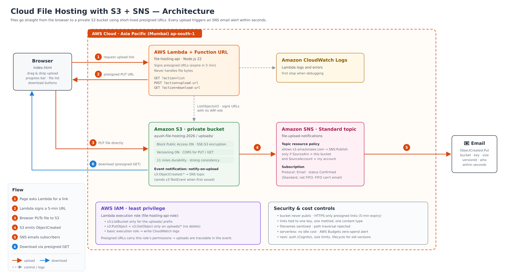

# ☁️ Cloud File Hosting with Amazon S3 + SNS

A serverless file hosting system on AWS. Users upload and download files through a simple web page, the bucket stays **completely private**, and every upload sends a **real-time email notification** through Amazon SNS.



## Highlights

- **Secure storage:** private S3 bucket with Block Public Access, SSE-S3 encryption at rest, and versioning for recovery.
- **Secure retrieval:** the browser never gets AWS credentials. A Lambda function issues **presigned URLs** that allow one action on one file and **expire after 5 minutes**.
- **Direct transfers:** files go straight from the browser to S3, so there's no server in the middle and no Lambda payload limit.
- **Event-driven notifications:** `s3:ObjectCreated:*` → SNS topic → email within seconds.
- **Least privilege:** the Lambda role can only list/read/write the `uploads/` prefix (no delete). The SNS topic policy only accepts publishes from this bucket and account (`aws:SourceArn` + `aws:SourceAccount`).
- **Serverless:** no servers to manage and close to zero cost when idle.

## How it works

| # | Step |
|---|------|
| 1 | The page calls `POST ?action=upload-url` on the Lambda Function URL |
| 2 | Lambda sanitises the filename and signs a PUT URL for `uploads/<timestamp>-<name>` (expires in 300 s) |
| 3 | The browser uploads the file **directly** to S3 with that URL |
| 4 | S3 emits an `ObjectCreated` event (event notification `notify-on-upload`) |
| 5 | SNS delivers it to all subscribers. The email includes bucket, key, size, versionId and uploader |
| 6 | Downloads work the same way through a presigned GET URL (`?action=download-url`) |

## Tech stack

| Layer | Service |
|-------|---------|
| Storage | Amazon S3 (versioning, SSE-S3, Block Public Access, CORS, event notifications) |
| Notifications | Amazon SNS (Standard topic, email subscription) |
| API | AWS Lambda (Node.js 22, AWS SDK v3) + Lambda Function URL |
| Security | AWS IAM (execution role + inline policy), SNS resource policy |
| Observability | Amazon CloudWatch Logs |
| Front end | Plain HTML/CSS/JS (drag and drop, upload progress) |

## Repository layout

```
lambda/            Lambda function (index.mjs) + dependencies
frontend/          index.html – the web app
infra/             SNS topic policy, Lambda IAM policy, S3 CORS rules
docs/              Architecture diagram + screenshots
```

## Deploy it yourself (console, about 30 min)

1. **S3:** create a bucket (Block Public Access ON, versioning ON, SSE-S3).
2. **SNS:** create a **Standard** topic `file-upload-notifications`. Set its access policy to `infra/sns-topic-policy.json` (replace `YOUR_ACCOUNT_ID` / `YOUR_BUCKET_NAME`). Add an **Email** subscription and confirm it.
3. **S3 event notification:** Properties → Event notifications → `All object create events` → SNS topic.
4. **Lambda:** Node.js 22 function. Run `npm install` in `lambda/`, zip `index.mjs`, `package.json` and `node_modules/`, and upload. Set env var `BUCKET_NAME`. Enable a Function URL with CORS (origin `*`, methods GET/POST, header `content-type`).
5. **IAM:** add `infra/lambda-s3-policy.json` as an inline policy on the Lambda role.
6. **S3 CORS:** Permissions → CORS → paste `infra/s3-cors.json`.
7. **Front end:** set `API_URL` in `frontend/index.html` to your Function URL and open the file in a browser.

## Screenshots

| | |
|---|---|
| Web app |  |
| Upload notification email |  |
| Bucket settings (versioning, encryption) |  |
| SNS topic + confirmed subscription |  |
| S3 event notification |  |

## Challenges & lessons learned

- **FIFO vs Standard topic:** I created a FIFO topic by mistake. FIFO topics only deliver to SQS and can't be an S3 event destination, so I switched to Standard.
- **S3 couldn't save the event notification:** S3 test-publishes to the topic when you save. The topic only had the default policy, so I added a statement allowing `s3.amazonaws.com` to publish, restricted by `aws:SourceArn` and `aws:SourceAccount` to prevent the confused-deputy problem.
- **Why presigned URLs:** proxying files through Lambda hits the ~6 MB payload limit and doubles the transfer. Presigned URLs keep the bucket private and let S3 handle the bytes.
- **CORS in two places:** the page calls both the Function URL and S3, so both need CORS rules.

## Known limitations / next steps

- Function URL auth is `NONE` for the demo. Next: Cognito + API Gateway JWT authorizer, with per-user prefixes.
- No upload size/type limit. Next: presigned **POST** with `content-length-range`.
- Listing isn't paginated (max 1,000 keys). Next: pagination or a DynamoDB metadata table.
- Next: malware scanning (GuardDuty Malware Protection for S3), lifecycle rules for old versions, hosting on S3 + CloudFront, Infrastructure as Code.

## Cost

Everything is pay-per-use (S3, Lambda, SNS) with nothing running when idle, so demo usage costs close to nothing. An AWS Budgets zero-spend alert guards against surprises.
